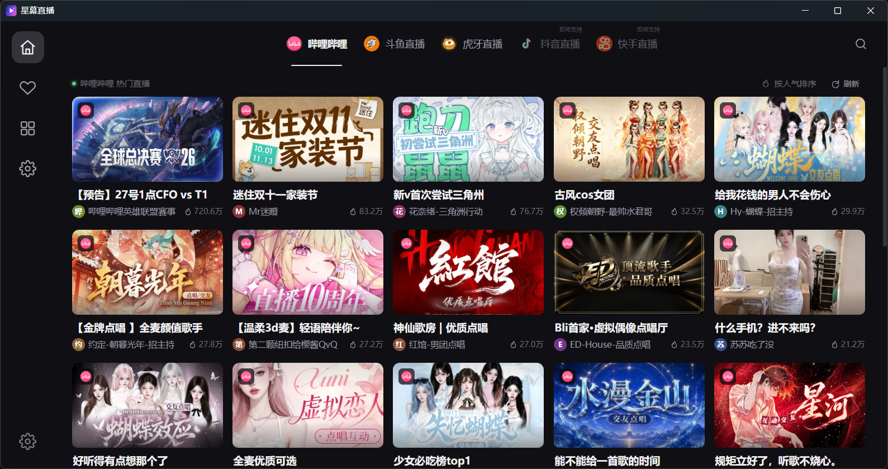
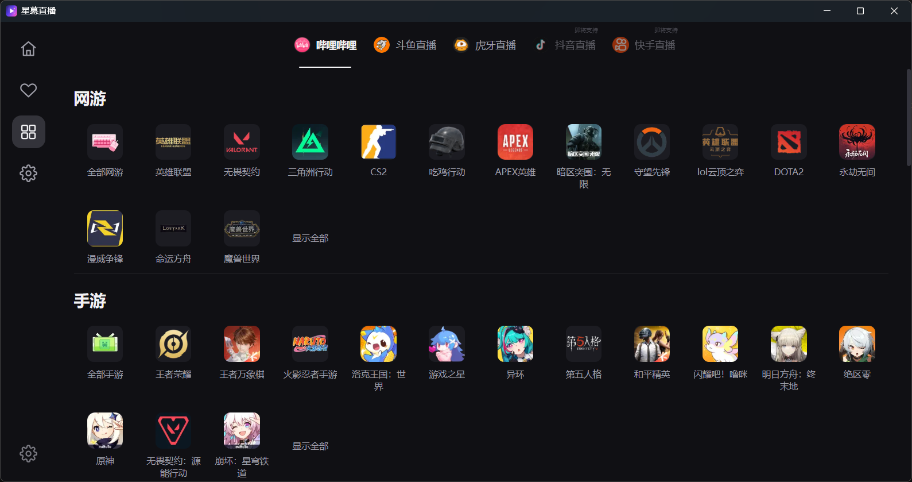
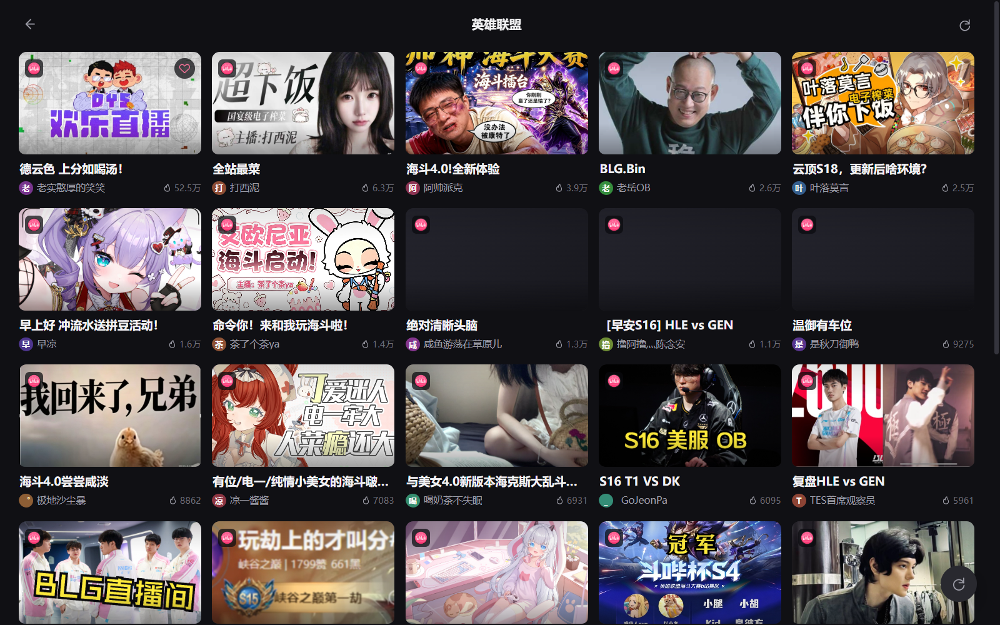
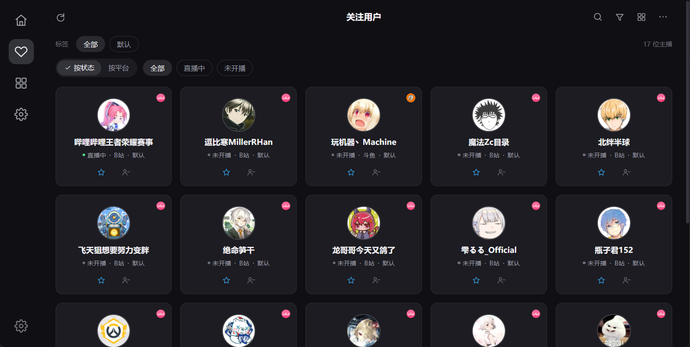
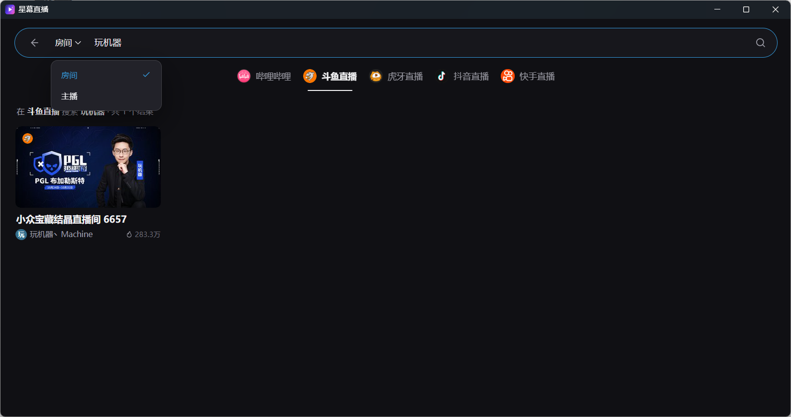
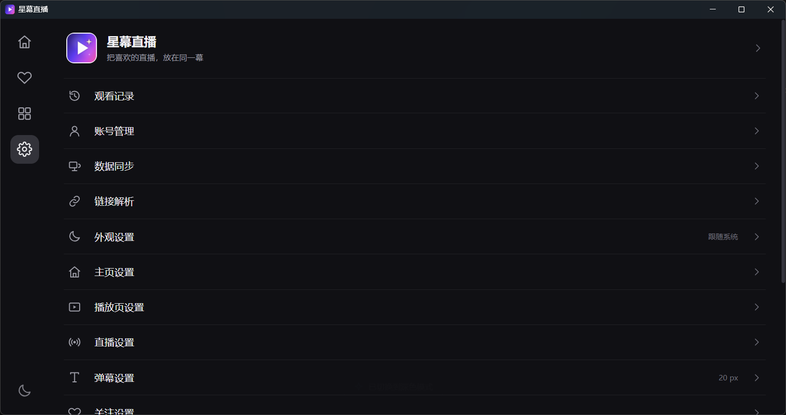
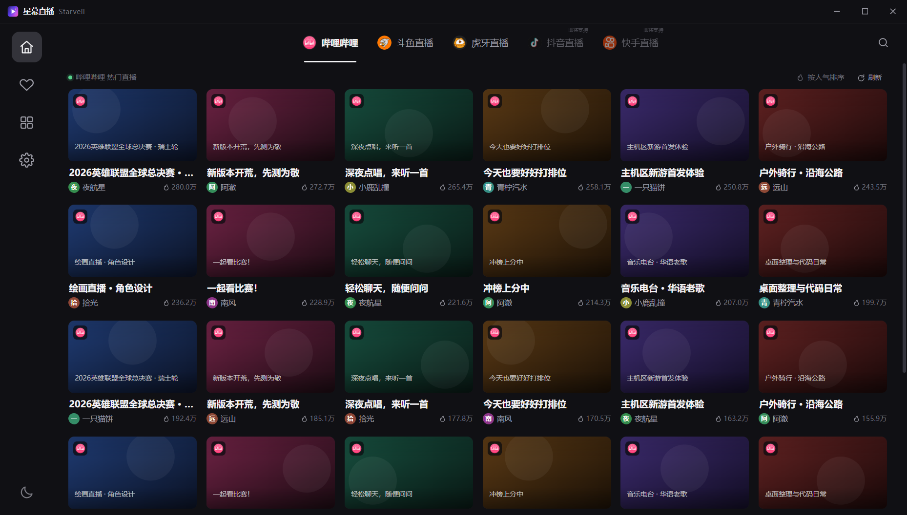
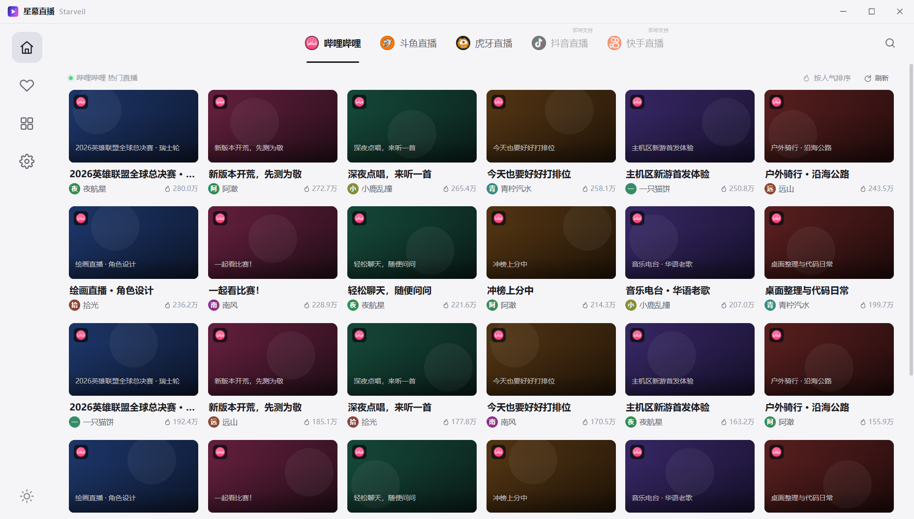

# 星幕直播 · Starveil

用 **Tauri 2 + WebView** 重写的聚合直播客户端，支持哔哩哔哩 / 斗鱼 / 虎牙 / 抖音 / 快手的  
推荐、搜索、直播间与播放；四站有分类浏览，抖音与前三站一样能看弹幕与聊天（快手弹幕尚未接入）。

界面是纯 HTML / CSS / ES Modules（无前端框架），播放走 mpegts.js（FLV over MSE）与  
hls.js（HLS），协议层是 Rust 写的 [`live_core`](src-tauri/vendor/live_core)（已内嵌进本仓库）。

> 当前版本 **0.6.2** · Windows 10/11 x64 + Android 8.0+（arm64-v8a）·
> GPL-3.0 · **非官方第三方客户端，仅供学习交流**



## 为什么做这个项目

- **原版在 Windows 上有不少显示问题**：窗口控件与缩放问题不好调，想验证换成 WebView 能不能解决。
- **独立的功能需求**：我有不少附加的需求，而原版的许多功能我也不需要。
- **顺带做一次 AI 辅助开发的完整实践**，趁手上工具额度还在，把想法一次落地。

参考项目：<https://github.com/June6699/dart_simple_live>  
（原版为 [xiaoyaocz/dart\_simple\_live](https://github.com/xiaoyaocz/dart_simple_live)，GPL-3.0）。

## 与参考项目的关系

|     | 原版 dart_simple_live                | 本项目 Starveil             |
| --- | ---------------------------------- | ------------------------ |
| 界面  | Flutter（GetX）                      | HTML / CSS / ES Modules  |
| 播放  | media_kit（libmpv）                  | mpegts.js（FLV over MSE）  |
| 平台  | Android / iOS / Windows / TV / CLI | Windows 桌面 + Android     |
| 协议层 | `simple_live_core`（Dart）           | `live_core`（Rust，移植五站协议） |
| 数据  | Hive                               | localStorage             |

布局、字号、间距、设置分组与直播间结构都对照原版逐页截图还原，  
差异集中在播放内核（用 MSE 而不是 libmpv）与还没覆盖的功能（见「已知限制」）。

## 截图

| 分类 | 分类下的房间列表 |
| --- | --- |
|  |  |

| 直播间（视频 + 滚动弹幕 + 聊天） | 关注 |
| --- | --- |
|  |  |

| 搜索 | 设置 |
| --- | --- |
|  |  |

| 桌面：自绘标题栏（深色） | 桌面：自绘标题栏（浅色） |
| --- | --- |
|  |  |

> 其余界面截图（登录、外观、弹幕参数等）见 [docs/img/](docs/img)。

## 功能

**外壳与导航**

- **桌面窗口**：无边框 + 自绘 38px 标题栏（图标、名称、最小化 / 最大化 / 关闭），
  拖动区交给系统，双击最大化，四边四角自带缩放热区；颜色跟主题走，关闭按钮悬停变红。
- **关闭即退出**：点关闭 / Alt+F4 / 任务栏关闭都直接结束进程，不驻留后台、没有托盘图标；
  **可以多开**，多个窗口是互不影响的独立进程。
- 左侧竖向图标栏（首页 / 关注 / 分类 / 设置）+ 顶部平台 Tab（哔哩哔哩 / 斗鱼 / 虎牙 / 抖音 / 快手）。
- 深浅色主题、8 色主题色板、界面密度、首次启动免责声明、全局提示、骨架屏与错误重试。

**Android**

- 竖屏是底部 TabBar，横屏回到左侧栏；状态栏与导航栏跟随当前主题。
- 直播间竖屏改上下分栏（视频在上、聊天在下），控制条只留音量 / 弹幕 / 设置 / 全屏，
  时间、清晰度、线路、画中画收进「更多」菜单。
- 外观设置可锁定「自动 / 固定竖屏 / 固定横屏」；「更多 → 小窗播放」进入系统画中画，
  小窗里只留视频并继续播放。
- 链接走系统浏览器打开，复制链接 / 直播流走系统剪贴板。

**首页 / 分类 / 搜索**

- 首页是按平台热度排的封面卡网格：平台角标、标题、主播、人气，支持手动刷新与「加载更多」；  
  增量插入卡片 + `content-visibility` + CDN 缩略图 + 懒加载，长列表滚动不掉帧。
- 分类页按一级分区纵向排列，二级分类图标网格，超过 15 项时「显示全部 / 收起」；  
  进入分类后是带返回、居中标题与分页的房间网格。
- 搜索页支持关键词、房间号直达、直播间链接解析，以及「主播」模式（昵称 / UID，B 站 UID 会反查直播间）。

**关注**

- 关注 / 取关、标签分组、按直播状态或平台筛选、网格 / 列表切换、导入导出。
- 排序为「正在直播 → 常看（进房次数）→ 最近访问」，右上角计数跟随当前筛选。

**设置**

一级列表是独立圆角卡片，二级详情是分组标题 + 圆角卡片行：  
观看记录、账号管理、数据同步、链接解析、外观、主页、播放页、直播、弹幕、关注、定时关闭、其他、免责声明、开源主页。

- **观看记录**分「记录 / 统计」两个视图：统计按本周 / 本月 / 今年 / 全部聚合出总时长、观看次数、
  主播数与日均，并给出主播时长排行（点一行直达直播间）。只统计真正在播的时间。
- **数据同步**四块：本机备份导出 / 导入（设置、关注、记录、搜索历史、统计、登录态）；
  从 **dart_simple_live 导出的 `simple_live_profile` 直接迁移**（关注、观看记录、弹幕与播放设置、
  关键词屏蔽、B 站 / 斗鱼登录态）；**局域网同步**（同 Wi-Fi 设备自动互相发现，直接拉取 / 发送整包配置，
  不经任何服务器）；**WebDAV 同步**（整包上传 / 下载、可选启动时自动拉取，跨网络可用）。
- **同步包范围**（局域网与 WebDAV 打包的是同一份，定义见 `importer.js` 的 `bundleScope()`）：
  含设置、关注、搜索历史、观看统计；**观看记录**与**登录 Cookie** 由「同步内容」卡片里的
  两个开关决定（前者默认带、后者默认不带）。永远不同步的是 WebDAV 口令、
  首次运行状态、窗口位置与聊天栏宽度、各平台记住的清晰度——后两类跟屏幕绑定。
  本机备份导出的是磁盘上的 JSON，所以始终带上 Cookie 与 WebDAV 口令，换机导入即可恢复登录态。

**直播间**

- 视频铺满，`object-fit` 可切适应 / 铺满 / 拉伸；顶部浮层显示房间标题、主播、分区、人气与关注。
- 弹幕层基于 [fly-barrage](https://github.com/feiafei27/fly-barrage)：canvas 渲染 + 虚拟轨道避让，
  支持颜色、字号、粗细、不透明度、描边、显示区域、行数、滚动速度、帧率上限、重复过滤与关键词/用户屏蔽；
  「性能档位」（平衡 / 流畅 / 极速）可一键关掉阴影与描边、降低画布精度，弹幕密集时更顺；
  这两项也能在直播间右侧「设置」页签里直接改，不必退回设置页；那里的弹幕参数
  统一用**预设值下拉**而不是滑块/数字框——面板窄，滑块拖不准，数字框在手机上还会弹键盘
  把面板顶走。设置页保留滑块，宽屏下更自由，两边读写同一份配置。
- 右侧聊天面板：主播信息 + 聊天 / SC / 关注 / 设置四个 Tab；SC 分「正在显示 / 历史」，到期自动归档。
- 底部控制条：音量、直播时长、清晰度、线路、弹幕开关、设置、画中画、全屏（直播不提供暂停）；  
  底部动作栏：刷新、关注、标签、分享、复制链接、复制直播流。
- 单击画面唤出控制条，双击或按 `F` 全屏，`D` 开关弹幕，`Esc` 返回，`↑/↓` 调音量；  
  鼠标静止 2.8 秒自动隐藏浮层。直播流卡顿或结束时自动换线 / 重连。

## 技术栈

| 层   | 选型                      | 说明                                |
| --- | ----------------------- | --------------------------------- |
| 外壳  | Tauri 2                 | Windows 用 WebView2、Android 用系统 WebView |
| 界面  | HTML / CSS / ES Modules | 无构建步骤，改完刷新即可                      |
| 播放  | mpegts.js               | FLV over MSE，直播低延迟                |
| 弹幕  | fly-barrage             | canvas + 虚拟轨道，避免叠字                |
| 协议层 | Rust `live_core`        | 五站详情 / 取流 / 推荐；B 站另有分类与搜索；四站有弹幕 |
| 流代理 | 内置 `127.0.0.1` 转发       | 补齐 CDN 需要的 Referer / CORS         |

## 目录结构

```
Starveil/
├─ src-tauri/
│  ├─ src/lib.rs            命令层：推荐/搜索/分类/房间/取流/弹幕/登录/系统集成
│  ├─ src/main.rs           桌面入口（安卓入口是 lib.rs 的 mobile_entry_point）
│  ├─ src/webdav.rs         WebDAV 同步：PROPFIND 探活 / PUT / GET
│  ├─ src/lan_sync.rs       局域网同步：UDP 23245 发现 + HTTP 23244 收发同步包
│  ├─ src/win32.rs          剪贴板与打开链接（Windows）
│  ├─ gen/android/          Android 工程；MainActivity.kt 提供方向 / 小窗 / 系统栏 / 链接桥接
│  ├─ capabilities/         Tauri 2 权限
│  ├─ tauri.conf.json       窗口、构建与打包配置（版本号以这里为准）
│  ├─ icons/                应用图标（tools/make_icon.py 生成）
│  └─ vendor/live_core/     内嵌直播协议层（B 站 / 斗鱼 / 虎牙 / 抖音 / 快手）
├─ web/
│  ├─ index.html
│  ├─ styles.css            设计变量、外壳、卡片、按钮、弹窗
│  ├─ pages.css             首页 / 分类 / 关注 / 设置 / 搜索
│  ├─ room.css              直播间、弹幕、聊天、播放器控制
│  ├─ mobile.css            移动端外壳与竖屏布局（全部挂在 html.is-mobile 下）
│  ├─ js/
│  │  ├─ app.js             路由、导航、平台切换、首次启动
│  │  ├─ platform.js        桌面 / Android 判定（IS_MOBILE）
│  │  ├─ api.js             Tauri 命令封装 + 浏览器演示数据
│  │  ├─ store.js           设置 / 关注 / 历史 / 观看统计 / 搜索历史持久化
│  │  ├─ importer.js        导入 dart profile / 备份 / 中立同步包，构建同步包
│  │  ├─ danmaku.js         弹幕层：封装 fly-barrage
│  │  ├─ titlebar.js        自绘标题栏：窗口按钮、拖拽、缩放热区
│  │  ├─ ui.js              卡片、弹窗、菜单、空态、加载态
│  │  ├─ icons.js           SVG 图标与平台图标
│  │  └─ pages/             home / category / category-rooms / follow / search / settings / room
│  ├─ assets/               平台图标、应用 logo
│  └─ vendor/               mpegts.js、fly-barrage.js、cryptojs、qrcode
├─ tools/
│  ├─ serve.py              浏览器预览用的静态服务（禁用缓存）
│  ├─ cdp.mjs               WebView2 / Edge DevTools 调试（截图、执行 JS、读 console）
│  ├─ shot.py               按进程截图与点击（DPI 感知）
│  └─ make_icon.py          生成 1024 图标、ico 与 web logo
├─ docs/
│  ├─ fly-barrage-changes.md  弹幕库改造清单与重建步骤
│  └─ img/                  界面截图（README 引用）
├─ .github/workflows/       CI：Windows 与 Android 并行构建 + 同一个 Release（手动触发）
└─ CHANGELOG.md             更新日志
```

## 运行与构建

**环境要求**：Windows 10/11 x64、WebView2 运行时、Rust 1.95（`rust-toolchain.toml` 已固定）、  
`cargo-tauri` 2.6+。构建 Android 另需 Android SDK / NDK 与 JDK 17，
并让 `ANDROID_HOME`、`NDK_HOME` 指向它们。

**开发**（前端无构建步骤，资源和正式包一样直接嵌进 exe）：

```bash
cd src-tauri && cargo run        # 直接跑，不需要另外起静态服务
```

debug 与 release 都不带 DevTools（`devtools` feature 已移除）：WebView2 不接受
`--remote-debugging-port`，所以界面调试统一走下面的 Edge 预览。

**Android**：

```bash
cargo tauri android build --apk --debug --target x86_64   # 模拟器
cargo tauri android build --apk --target aarch64          # 真机 / 发布
```

产物在 `src-tauri/gen/android/app/build/outputs/apk/`。`gen/android` 已入库；
**改包名后必须删掉重新 `cargo tauri android init`**（CLI 不迁移包名）。

`--target aarch64` 打的是 release 包，但 **tauri 不会替你签名**：产物是
`app-universal-release-unsigned.apk`，直接装会被系统拒绝。要用 debug keystore 补签：

```bash
APKSIGNER=$(find "$ANDROID_HOME/build-tools" -name "apksigner*" ! -name "*.jar" | sort | tail -1)
"$APKSIGNER" sign --ks ~/.android/debug.keystore --ks-pass pass:android \
  --key-pass pass:android --ks-key-alias androiddebugkey \
  --out Starveil_arm64.apk app-universal-release-unsigned.apk
```

release 包还有两个必须记住的坑（CI 已经处理，本地改构建配置时要一起带上）：
默认禁止明文 HTTP，而 FLV 走的是本机流代理，所以 `res/xml/network_security_config.xml`
只给 `127.0.0.1` / `localhost` 开了口子、并在 manifest 里引用；
R8 会把 `MainActivity` 的静态方法改名，而 Rust 侧是按名字调的，
`proguard-rules.pro` 里必须 `-keepclassmembers` 保住它们。
CI 跑的也是这条命令，产物挂到 Release 的 `Starveil_<版本>_arm64.apk`。

调试界面用 DevTools 协议（同一个端口在 Edge 上是可用的）：

```bash
python tools/serve.py 1420 web   # 浏览器预览用，禁缓存
# 另开 Edge 指向 http://127.0.0.1:1420/index.html?titlebar=1，并加 --remote-debugging-port=9225
CDP_PORT=9225 node tools/cdp.mjs shot shot.png
CDP_PORT=9225 node tools/cdp.mjs eval "document.title"
```

**打包**：

```bash
cargo tauri build --no-bundle
# 产物：src-tauri/target/release/starveil.exe（会把 web/ 嵌入二进制）
```

**数据位置**：桌面端把设置、关注、观看记录与登录 Cookie 存在  
`%LOCALAPPDATA%\Starveil\WebView2`，删除该目录会同时清掉设置与登录态；  
Android 端在同一套 localStorage 键名下，位于应用私有目录（`/data/data/com.banlany.starveil`），
卸载即清空。

## 后端命令

| 命令                                                                        | 说明                            |
| ------------------------------------------------------------------------- | ----------------------------- |
| `recommend(platform, page)`                                               | 平台热度推荐                        |
| `search(platform, keyword)`                                               | 搜索直播间                         |
| `search_anchors(platform, keyword, page)`                                 | 搜索主播（B 站纯数字 UID 会反查直播间）       |
| `categories(platform)`                                                    | 分类树                           |
| `category_rooms(platform, parentId, subId, name, page)`                   | 分类下直播间（分页）                    |
| `open_room(platform, roomId)`                                             | 房间详情 + 清晰度，会话存在后端             |
| `play(key, index)`                                                        | 按清晰度取直链与请求头                   |
| `start_danmaku(key, signature?, userId?)` / `stop_danmaku()`              | 弹幕订阅；消息走 `danmaku`，状态走 `danmaku-status` |
| `resolve_input(current, input)`                                           | 链接 / 房间号解析                    |
| `copy_text(text)` / `open_url(url)` / `quit_app()`                        | 剪贴板、浏览器、退出                    |
| `set_cookie(platform, cookie)` / `clear_cookie(platform)`                 | 注入 / 清除登录 Cookie 并重建 LiveCore |
| `login_status(platform, cookie)`                                          | 校验登录态                         |
| `open_login_window(platform)` / `capture_login(platform)`                 | 独立登录窗口、读出该域的 Cookie |
| `bili_qr_generate()` / `bili_qr_poll(key)`                                | B 站扫码登录                       |
| `douyu_qualities(key, signedArgs)` / `douyu_play(key, index, signedArgs)` | 斗鱼 WebView 签名后的清晰度 / 直链       |
| `webdav_test(url, username, password, allowInsecureTls)`                  | 探测 WebDAV：认证、目标文件是否存在            |
| `webdav_upload(...)` / `webdav_download(...)`                             | 上传 / 下载整包同步 JSON                |
| `lan_sync_start()` / `lan_sync_stop()` / `lan_sync_status()`              | 局域网同步服务的启停与状态                |
| `lan_sync_publish(content)` / `lan_sync_inbox()`                          | 发布本机同步包 / 取走对端推来的包            |
| `lan_sync_pull(address, port)` / `lan_sync_push(...)` / `lan_sync_probe(...)` | 从对端拉取、推给对端、手动地址探活        |
| `set_screen_orientation(mode)`                                            | 安卓屏幕方向：`auto` / `portrait` / `landscape` |
| `enter_picture_in_picture()` / `in_picture_in_picture()`                  | 安卓小窗（系统画中画）的进入与状态查询            |
| `set_system_bar(color, light)`                                            | 安卓状态栏 / 导航栏配色与图标明暗，跟随主题          |

## 已知限制

- 播放内核：FLV 走 mpegts.js（FLV over MSE），HLS 走 hls.js；线路菜单会标出哪条是 HLS。
  虎牙没有可用的 HLS 出口（服务端一律 403），所以只有 FLV。画质切换细节与原生 mpv 不完全一致。
- 抖音、快手已支持观看与账号登录（设置 → 账号管理里开独立登录窗口，登录后一键读取 Cookie）。
  抖音弹幕已接入：它要求 webmssdk 生成的 `signature`，所以签名在 WebView 里算
  （`web/vendor/douyin-sign.js` 只在进抖音房间时懒加载），连接与 protobuf 解码在 Rust 里做。
  快手弹幕仍未接入（自定义 protobuf + 页面 token），抖音搜索与分类、快手搜索（需要 did 注册）
  也暂不可用，界面上会给出对应提示。
- 弹幕连接状态统一显示在聊天栏顶部：「连接中 / 已连接 / 连接失败（附原因 + 重试）/
  本平台暂不支持」。连不上时不会再只剩一片空白，也不会假报「连接正常」。
- 抖音首页的「加载更多」是「再拉一批 + 去重」：抖音推荐流没有真正的分页游标，
  每批只给 6 条，所以翻几次之后可能重复较多。
- 发送弹幕默认隐藏（属于写操作，需要主动解锁），且目前只有 B 站实现了发送接口。
- 贡献榜 / 亲密榜的数据源不接（需求已取消）。
- 虎牙不支持登录；斗鱼未登录时最高画质约 10 分钟过期，过期后会触发自动重取流。
- 自绘标题栏意味着窗口没有系统边框，**失去了 Windows 原生的「贴边吸附（Aero Snap）」**。
- 关闭窗口即退出进程，**没有托盘常驻、不保留后台播放**；换来的是不会堆出多个托盘图标，
  且可以随意多开。
- **Android**：斗鱼弹幕连不上（服务端拒绝 rustls 握手，桌面走 WebView 签名不受影响）；
  退到后台会暂停播放，没有做 MediaSession / 前台服务，所以**不支持后台听声**。
  视频编解码由系统 WebView 提供，老机器上的表现取决于系统 WebView 版本。
- 所有数据默认只在本机；只有自己配了 WebDAV 并手动触发（或显式打开自动拉取）时，
  才会把不含 Cookie 的同步包传到那台服务器；局域网同步也只在打开「数据同步」页时启动，
  数据点对点直传，收到的一方要确认才会覆盖。

## 已知问题与排查

- **窗口全黑**：部分环境下 WebView2 的浏览器主进程会在启动后 1~3 秒崩溃
  （GPU 进程起不来 → `GPU process isn't usable. Goodbye.`），表现为一片黑。
  根因是 Chromium 的 GPU 沙箱要给子进程创建「受限令牌 + 嵌套 Job Object」，
  而**父进程本身已经在某个 Job 里时**（Windows 桌面 Job、部分沙箱与容器环境）就建不出来。
  建窗前会检测当前进程是否处于 Job 中，是则自动关闭 GPU 沙箱并记住结论
  （`%LOCALAPPDATA%\Starveil\gpu-sandbox-broken.flag`）；沙箱正常的机器不受影响。
  需要手动控制时：`STARVEIL_FORCE_GPU_SANDBOX=1` 强制保留，
  `STARVEIL_DISABLE_GPU_SANDBOX=1` 强制关闭。
- **运行日志**：`%LOCALAPPDATA%\Starveil\starveil.log`，记录启动、窗口地址、
  前端初始化与 GPU 沙箱的判定结果；反馈问题时请附上这个文件。
- **拿 Chromium 自己的日志**（排查 WebView2 问题最有效的手段）：
  `WEBVIEW2_ADDITIONAL_BROWSER_ARGUMENTS=--enable-logging --v=1 --log-file=<路径>`。
  该变量里的参数是**追加**到配置 `additionalBrowserArgs` 之后的，不会覆盖它。

## 文档

- [CHANGELOG.md](CHANGELOG.md)：版本更新日志
- [docs/fly-barrage-changes.md](docs/fly-barrage-changes.md)：弹幕库改动清单与重建步骤
- [docs/img/](docs/img)：界面截图

## 许可与致谢

本项目是**独立仓库**，不是原项目的官方分支，与原项目作者无隶属关系。

- **界面**：布局结构、交互细节与平台图标参考 [`dart_simple_live`](https://github.com/xiaoyaocz/dart_simple_live)（GPL-3.0）。
- **协议**：各平台的房间信息、清晰度、取流签名与弹幕编解码，是从原项目 Dart 实现
  （`simple_live_core`）移植为 Rust 的（`src-tauri/vendor/live_core`），并非原创；
  迁移过程中补充了虎牙 Tars `getCdnTokenInfoEx`、斗鱼 WebView 签名等实现。
  因此本项目属于原项目的衍生作品，沿用 **GPL-3.0**，完整源码随本仓库提供，见 [LICENSE](LICENSE)。
- **依赖**：播放使用 [mpegts.js](https://github.com/xqq/mpegts.js)（Apache-2.0）；
  弹幕使用 [fly-barrage](https://github.com/feiafei27/fly-barrage)（MIT，本地构建 IIFE 后放进 `web/vendor/`）；
  斗鱼签名环境使用 CryptoJS（MIT）；登录二维码使用 qrcode-generator（MIT）。

## 免责声明

本项目仅用于个人学习与技术研究，**不提供、不存储、不转播任何直播内容**，也不绕过任何平台的付费或登录限制。

所有视频流、弹幕、封面与商标归各直播平台及主播所有。请遵守所在地区法律法规与各平台服务条款，
**请勿用于商业用途**。因使用本项目产生的任何后果由使用者自行承担。

