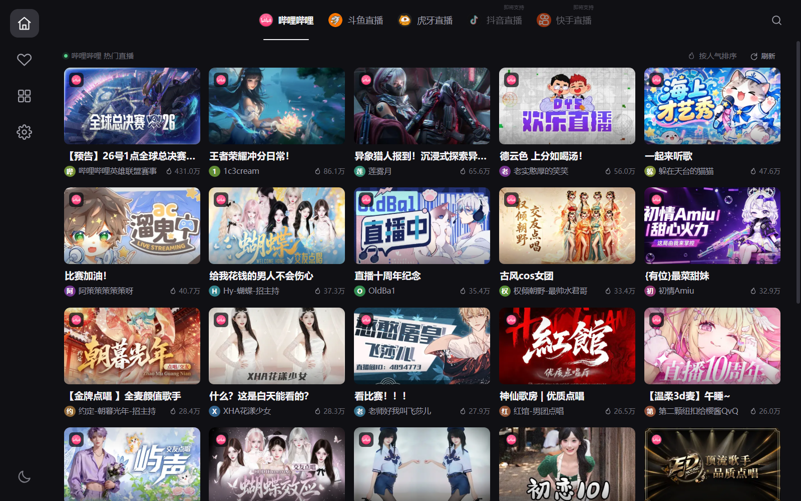
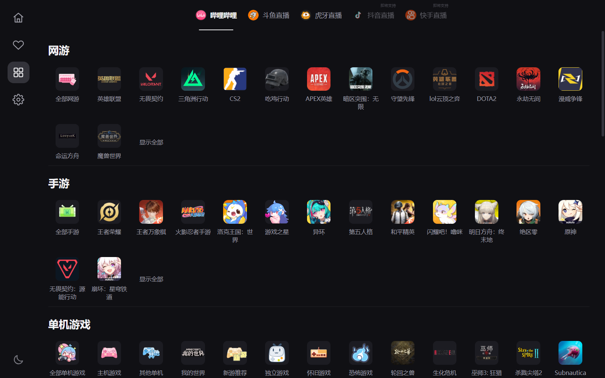
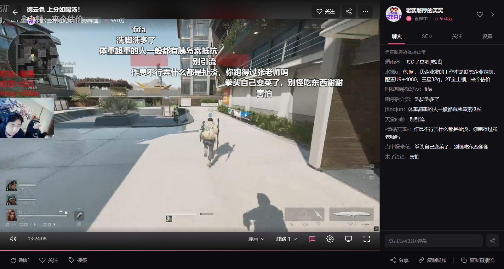
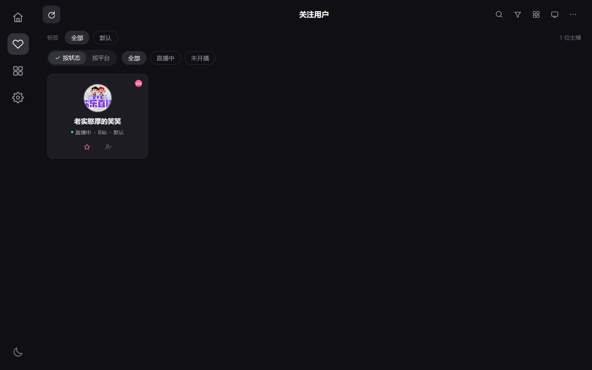
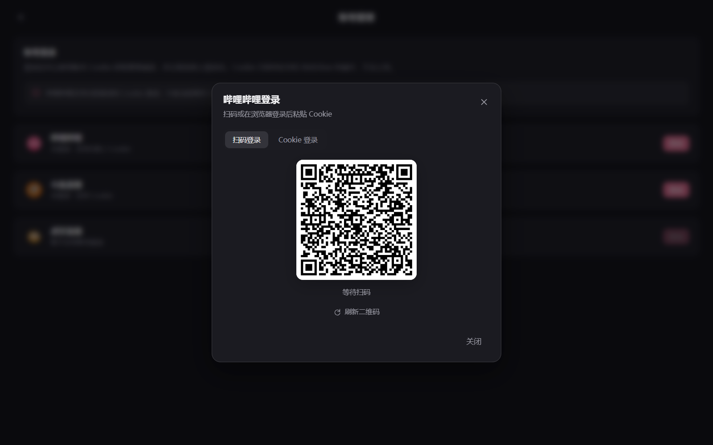
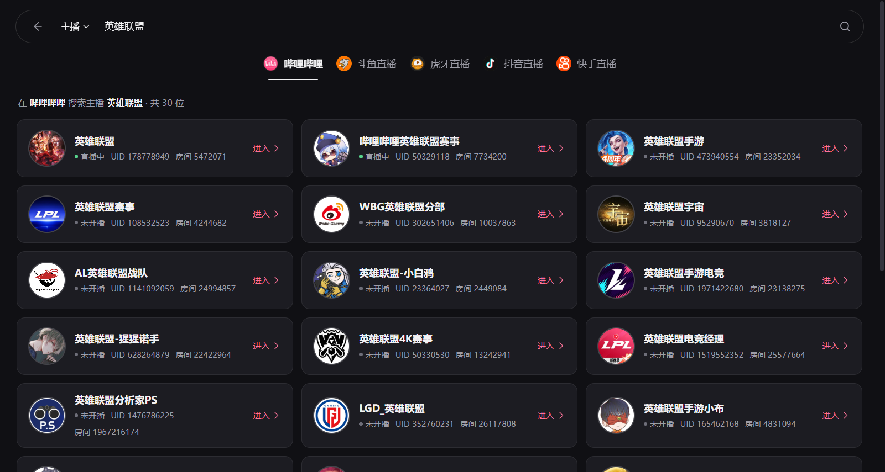
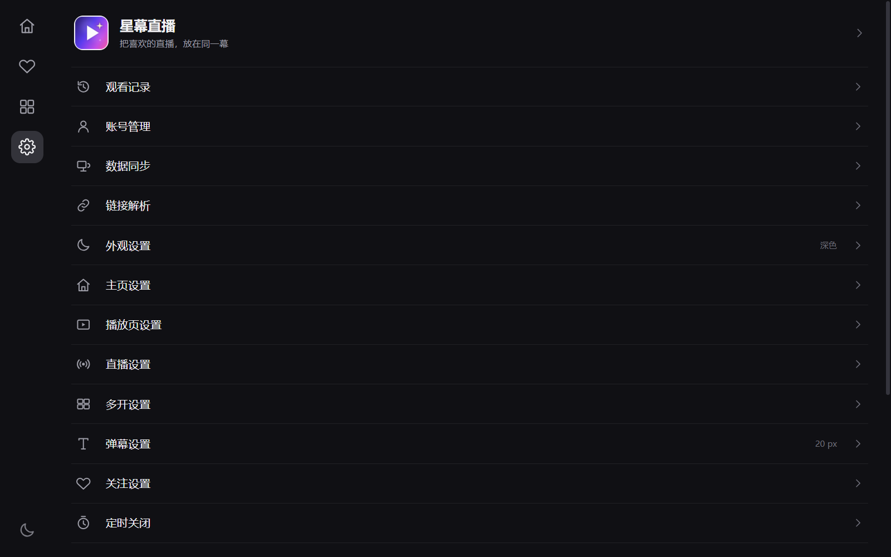

# 星幕直播 · Starveil（Tauri 版）

用 **Tauri 2 + WebView2** 复刻 [`dart_simple_live`](https://github.com/xiaoyaocz/dart_simple_live) 的桌面端：
界面是纯 HTML / CSS / ES Modules，播放走 mpegts.js（FLV over MSE），
直播协议层复用 Rust 的 [`live_core`](src-tauri/vendor/live_core)，并已把需要的源码迁进本工程，
不再依赖 `gpui_simple_live` 的相对路径。

品牌重做为 **星幕直播 / Starveil**：新名称、新图标，程序名、窗口标题、安装目录
与数据目录都随之更新；原版仅作为界面与交互参考。

## 0.3.1 更新

- B 站首页改为 CDN 缩略图（`@480w_270h_1c.webp`），并取消滚动自动追加，改成底部「加载更多」；
  30 张卡片实测平均帧耗时约 6 ms，60 张约 6 ms，不再出现滚动掉帧。
- 虎牙直播修复：按 Dart 版的做法，每次取流都调用 Tars `getCdnTokenInfoEx` 换新 anti-code，
  再拼 CDN 地址；默认清晰度改为蓝光 4M，并加 1MB 缓冲、卡顿自动换线。实测可连续播放。
- 搜索新增「主播」模式：可按主播昵称或主播 ID 搜索；B 站纯数字 UID 会反查直播间，
  结果展示 UID、房间号、开播状态和头像。
- 直播间去掉暂停按钮，单击画面只唤出控制条，双击画面或按 `F` 全屏。
- 修正展开聊天区按钮的箭头方向（改为向左）。
- 全屏只看画面：隐藏聊天栏、刷新/关注/分享/标签/复制链接底栏；顶部返回/标题栏与播放控制条在 2.8 秒后自动隐藏，退出全屏恢复。
- 关注按钮改为「实心爱心 + 主题色」，不再整块铺主题色背景；聊天面板的关注 Tab 改成主播卡片网格。
- 移除聊天面板的「贡献榜」Tab。
- 搜索类型下拉菜单改为左对齐、与搜索框留出间距，并在路由切换时自动关闭。
- 进入直播间不再弹「点击画面开始播放」；未登录时提示 B 站最高画质不可用 / 斗鱼最高画质仅可体验 10 分钟。
- 首页状态栏增加「刷新」按钮。
- 「记住窗口大小和位置」已接 Tauri 窗口 API：退出前保存内尺寸/外位置/最大化状态，下次启动恢复。
- `live_core` 迁入 `src-tauri/vendor/live_core`，Tauri 构建不再依赖 gpui 工作区。

## 0.3.0 更新

- 首页滚动优化：追加新页时只插入新卡片，配合 `content-visibility`、懒加载、异步解码、
  去掉卡片上的 `backdrop-filter` 与滚动节流；120 张卡片实测平均帧耗时约 8 ms。
- 斗鱼直播间打通：签名脚本交给 WebView JS 引擎执行，本机 127.0.0.1 流代理补齐 Referer，
  清晰度、线路、播放、弹幕均可用。
- 虎牙首页修复：`live_core` 对 gzip 响应做兜底解压，不再出现「返回的不是 JSON」。
- 登录：哔哩哔哩扫码 / Cookie 登录，斗鱼 Cookie 登录；按平台独立保存 Cookie 并注入取流。
- 关注页取消关注按钮改为「用户减号」图标，不再使用爱心。
- 弹幕速度立即生效：调整持续时间会同步改变当前屏幕上弹幕的播放速率。
- 新品牌「星幕直播 / Starveil」与新图标，程序名、窗口标题、数据目录同步更新。

参考程序：原版 Simple Live Flutter Windows 客户端 1.13.2。
界面结构、字号、间距、设置分组和直播间布局都对照原版逐页截图还原，见文末「参考与差异」。



| 分类 | 直播间 |
|------|--------|
|  |  |

| 关注 | 登录 |
|------|------|
|  |  |

| 搜索主播 | 设置 |
|----------|------|
|  |  |

## 已实现

### 外壳与导航

- 原生 Windows 标题栏 + 左侧竖向图标栏：首页 / 关注 / 分类 / 设置。
- 顶部平台 Tab：哔哩哔哩 / 斗鱼直播 / 虎牙直播 / 抖音直播 / 快手直播，
  带平台图标、当前项下划线；未接入的平台有「即将支持」标记和说明弹窗。
- 首次启动免责声明、深浅色主题、主题色色板、全局提示、骨架屏、错误重试。

### 首页 / 分类 / 搜索

- 首页按平台热度推荐，封面卡网格、平台角标、主播、人气；支持右上角手动刷新和底部「加载更多」。
  追加新页时只插入新卡片，配合 `content-visibility`、CDN 缩略图与图片懒加载，避免长列表滚动卡顿。
- 分类页按一级分区纵向排列，二级分类图标网格，超过 15 项时「显示全部 / 收起」。
- 分类房间页：顶部返回 + 居中标题 + 刷新，封面网格、收藏心形、右下悬浮刷新、分页。
- 搜索页：胶囊输入框、平台 Tab、最近搜索、关键词搜索、房间链接解析、纯房间号直达；
  「主播」模式可按昵称或主播 ID / UID 搜索并直接进入直播间。
- 观看记录、关注列表、搜索历史都持久化在本机 localStorage。

### 关注

- 关注/取消关注、标签分组、按直播状态或平台筛选、网格/列表切换。
- 关注卡片支持设置标签、取消关注；关注页头部支持搜索、筛选、导出/导入关注列表。
- 自动更新关注状态等设置在「设置 → 关注设置」中持久化。

### 设置

一级列表与二级详情完整还原，详情是「分组标题 + 圆角卡片行」：

| 页面 | 主要选项 |
|------|----------|
| 外观设置 | 跟随系统 / 浅色 / 深色、动态取色、8 色主题色板、界面密度 |
| 主页设置 | 默认平台、卡片尺寸、回到首页自动刷新、加载更多 |
| 播放页设置 | 硬件解码、记住清晰度、自动换线、自动刷新直播流、强制 HTTPS、画面尺寸 |
| 直播设置 | 自动全屏、关播换下一个、后台播放、手势、最小化隐藏弹幕 |
| 多开设置 | 默认收起聊天区、布局间距、关闭所有多开窗口 |
| 弹幕设置 | 屏蔽开关、关键词/用户屏蔽、显示区域、行数、字体、粗细、速度、不透明度、描边、帧率、安全边距、重复过滤 |
| 关注设置 | 自动更新、更新间隔、线程数、每页数量 |
| 定时关闭 | 开关与倒计时分钟数，到点退出应用 |
| 其他设置 | 记住窗口、日志、自动更新、重置所有设置 |
| 数据同步 | 导出 / 导入设置、关注、观看记录 JSON |
| 链接解析 | 粘贴链接解析出平台与房间号，一键进入 |
| 账号管理 | 哔哩哔哩扫码 / Cookie 登录、斗鱼 Cookie 登录、退出登录；每个平台独立 Cookie |
| 免责声明 | 完整声明与同意状态 |
| 关于 | 版本、协议层、播放器、开源主页 |

### 直播间

- 视频区铺满、`object-fit` 可切换适应/铺满/拉伸，mpegts.js 播放 FLV。
- 顶部浮层：返回、房间标题、主播、分区、人气、关注、分享、更多。
- 弹幕层：按行调度、颜色、粗细、字号、不透明度、描边、显示区域、行数、滚动速度、
  重复过滤、关键词/用户屏蔽；支持「弹幕开关」即时生效。
- 右侧聊天面板：主播头像/昵称/平台/在线人数、聊天 / SC / 关注 / 贡献榜 / 设置 五个 Tab，
  聊天消息滚动、系统消息弱化、滚到底自动跟随。
- 底部控制条：音量、时钟、清晰度、线路、弹幕开关、设置、画中画、全屏（直播不提供暂停）。
- 单击画面唤出控制条，双击画面或按 `F` 全屏。
- 底部动作栏：刷新、关注、标签、分享、复制链接、复制直播流。
- 键盘：`F` 全屏、`D` 弹幕、`Esc` 返回、`↑/↓` 音量。
- 鼠标静止 2.8 秒自动隐藏顶部浮层/控制条和光标；全屏时聊天栏、底部动作栏直接隐藏。
- 直播流异常结束时自动重连，失败后给出刷新/换线提示。
- 进入房间记录观看历史；关注状态写入本机。

## 结构

```
tauri_simple_live/
├─ src-tauri/
│  ├─ src/main.rs           命令：推荐/搜索/分类/房间/取流/弹幕/剪贴板/链接解析
│  ├─ capabilities/          Tauri 2 权限（事件监听、窗口尺寸/位置）
│  ├─ tauri.conf.json        窗口、构建与打包配置
│  ├─ icons/icon.ico         星幕直播图标（tools/make_icon.py 生成）
│  └─ vendor/live_core/      内嵌的直播协议层（B 站 / 斗鱼 / 虎牙 + Tars token）
├─ web/
│  ├─ index.html
│  ├─ styles.css             设计变量、外壳、卡片、按钮、弹窗
│  ├─ pages.css              首页/分类/关注/设置/搜索
│  ├─ room.css               直播间、弹幕、聊天、播放器控制
│  ├─ js/
│  │  ├─ app.js              路由、导航、平台切换、首次启动
│  │  ├─ api.js              Tauri 命令封装 + 浏览器演示数据
│  │  ├─ store.js            设置/关注/历史/搜索历史持久化
│  │  ├─ ui.js               卡片、弹窗、菜单、空态、加载态
│  │  ├─ icons.js            SVG 图标与平台图标
│  │  └─ pages/              home / category / category-rooms / follow / search / settings / room
│  ├─ assets/                应用 logo
│  └─ vendor/mpegts.js       FLV over MSE
├─ tools/cdp.mjs             WebView2 DevTools 调试脚本（截图/执行 JS/读 console）
├─ tools/make_icon.py        生成 1024 图标、ico 与 web logo
├─ docs/                     原版对照记录与截图
└─ dist/                     本机构建产物（Starveil.exe 不提交到 git）
```

## 源码仓库

本目录已初始化为独立 git 仓库，`src-tauri/target/`、`src-tauri/gen/schemas/`、
`dist/*.exe` 等构建产物不会入库；源码、`Cargo.lock`、截图与 `dist/README.txt` 会提交。

## 运行

前置：Windows 10/11、WebView2 运行时、Rust 1.95（`rust-toolchain.toml` 已固定）、
`cargo-tauri` 2.6+。

### 开发（热更新前端）

前端没有构建步骤，起一个静态服务让 Tauri 的 `devUrl` 指向它：

```powershell
cd tauri_simple_live
python -m http.server 1420 --bind 127.0.0.1 --directory web
# 另开一个终端
cargo tauri dev
```

改 `web/` 下的 HTML/CSS/JS 后刷新窗口即可。调试脚本示例：

```powershell
$env:CDP_PORT = "9224"
node tools/cdp.mjs info
node tools/cdp.mjs shot shot.png
node tools/cdp.mjs eval "document.title"
node tools/cdp.mjs click "#topbar-search"
```

### 构建独立 exe

```powershell
cd tauri_simple_live
cargo tauri build --no-bundle
```

产物：`src-tauri/target/release/starveil.exe`。
该构建会把 `web/` 嵌入二进制，不需要静态服务器；窗口规格在 `tauri.conf.json`。

本次已构建的独立版本放在 **`dist/Starveil.exe`**（约 16 MB，双击运行，需要 WebView2 运行时），
`dist/README.txt` 有运行与数据位置说明。

Debug 构建也可以直接运行（会把资源嵌入）：

```powershell
cargo tauri build --debug --no-bundle
.\src-tauri\target\debug\starveil.exe
```

## 后端命令

| 命令 | 说明 |
|------|------|
| `recommend(platform, page)` | 平台热度推荐 |
| `search(platform, keyword)` | 搜索直播间 |
| `search_anchors(platform, keyword, page)` | 搜索主播；B 站纯数字 UID 会反查直播间 |
| `categories(platform)` | 分类树 |
| `category_rooms(platform, parentId, subId, name, page)` | 分类下直播间（分页） |
| `open_room(platform, roomId)` | 房间详情 + 清晰度，会话存在后端 |
| `play(key, index)` | 按清晰度取直链与请求头 |
| `start_danmaku(key)` / `stop_danmaku()` | 弹幕订阅，消息通过 `danmaku` 事件推送 |
| `resolve_input(current, input)` | 链接/房间号解析，返回平台、房间号、短链标记 |
| `copy_text(text)` / `open_url(url)` / `quit_app()` | 剪贴板、浏览器、退出 |
| `set_cookie(platform, cookie)` / `clear_cookie(platform)` | 按平台注入 / 清除登录 Cookie 并重建 LiveCore |
| `login_status(platform, cookie)` | 校验 B 站登录态；斗鱼返回 Cookie 配置状态 |
| `bili_qr_generate()` / `bili_qr_poll(key)` | B 站扫码登录二维码与轮询 |
| `douyu_qualities(key, signedArgs)` / `douyu_play(key, index, signedArgs)` | 斗鱼 WebView 签名后的清晰度 / 直链 |

## 状态与已知限制

- ✅ 哔哩哔哩：推荐、分类、搜索、详情、取流、弹幕、聊天。
- ✅ 虎牙：推荐、分类、搜索、详情、取流；首页响应为 gzip 时已在 `live_core` 里兜底解压。
  取流按 Dart 版移植了 Tars `getCdnTokenInfoEx`，每次播放换新 anti-code，并默认蓝光 4M；
  弹幕协议（Tars）尚未接入，会给出系统提示。
- ✅ 斗鱼：推荐、分类、搜索、详情、清晰度与播放已打通。签名脚本交给 WebView 的
  JS 引擎执行（与 Dart 版 QuickJS 等价），CDN 的 Referer 由本机流代理补齐；
  登录后可携带 Cookie 获取更稳定的画质。
- ⏳ 抖音 / 快手：Tab 已预留，接口（签名、protobuf 弹幕、播放地址）未移植。
- ✅ 账号：哔哩哔哩扫码登录 / Cookie 登录，斗鱼 Cookie 登录；登录态按平台独立保存并注入取流。
  虎牙暂不支持登录。
- ⏳ 多开同屏、自动更新、后台常驻：界面入口已留，逻辑未接。
- ⏳ SC / 贡献榜：聊天面板已有 Tab 与空态，数据源尚未接入。
- 关注状态更新目前以进入直播间时写入的本地记录为准，不做后台批量轮询。
- 播放地址通常有时效（斗鱼约 10 分钟、虎牙部分线路更短），播放页会在 9 分钟自动重取，
  异常结束时也会自动重连。
- 所有数据仅保存在本机 `localStorage`，不上传服务器。

## 参考与差异

- 原版运行截图与逐页记录：`docs/reference-spec.md`、`docs/screenshots/`。
- 布局按桌面端宽屏还原：左侧 88 px 图标栏、64 px 顶栏、自适应封面网格（宽度越大列数越多）。
- 原版使用 Flutter + media_kit；这里用 WebView2 + mpegts.js，因此播放内核、画质切换细节
  与原生 mpv 不完全一致，但交互与信息结构保持一致。
- 原版设置项很多是移动端专属（后台保活、小窗、iOS 硬解等），桌面版只保留桌面有意义的项。

## 许可与致谢

- 界面结构、交互与平台图标参考 [`dart_simple_live`](https://github.com/xiaoyaocz/dart_simple_live)，
  原项目以 **GPL-3.0** 发布；本项目随之使用 GPL-3.0，见 `LICENSE`。
- 协议层来自 GPUI 版的 `live_core`（哔哩哔哩 / 斗鱼 / 虎牙），已迁入 `src-tauri/vendor/live_core`；
  其中虎牙部分补了 Tars `getCdnTokenInfoEx` 取新 token 的实现。
- 播放使用 [mpegts.js](https://github.com/xqq/mpegts.js)（Apache-2.0）。
- 斗鱼签名脚本运行环境使用 CryptoJS（MIT）；登录二维码使用 qrcode-generator（MIT）。

## 免责声明

本项目仅用于学习与技术研究，不提供、不存储、不转播任何直播内容。
所有视频流、弹幕、封面与商标归各直播平台及主播所有。请遵守所在地区法律法规与平台服务条款。
