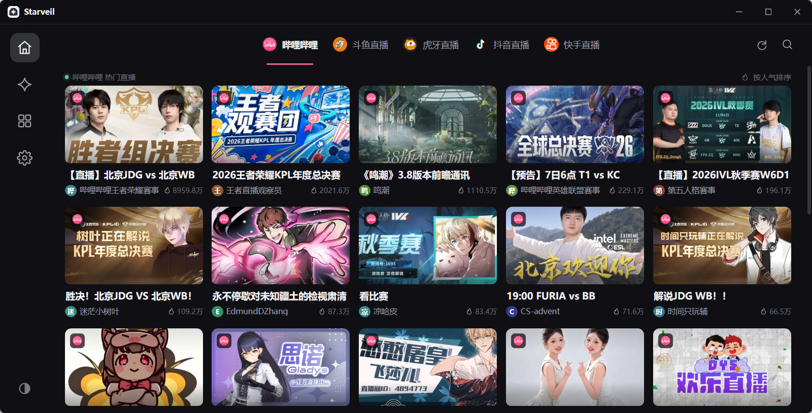
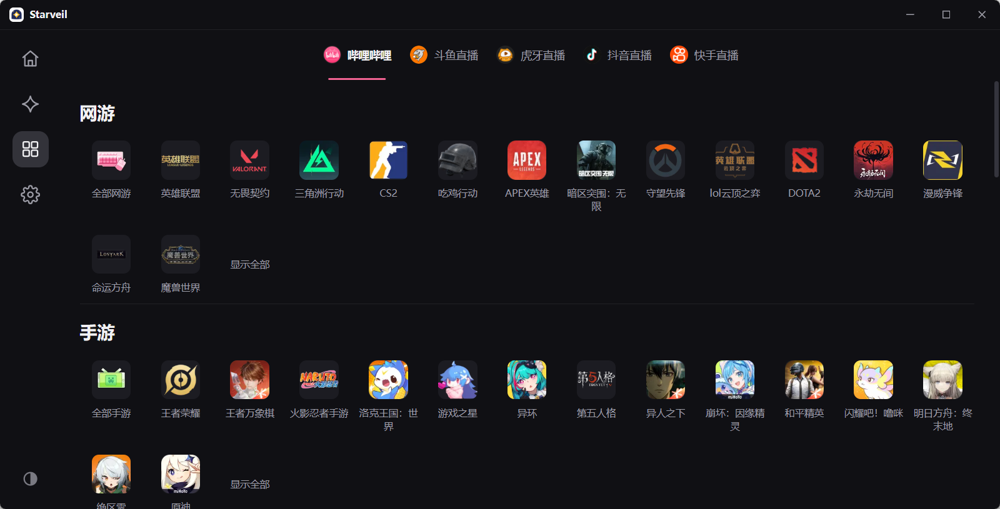
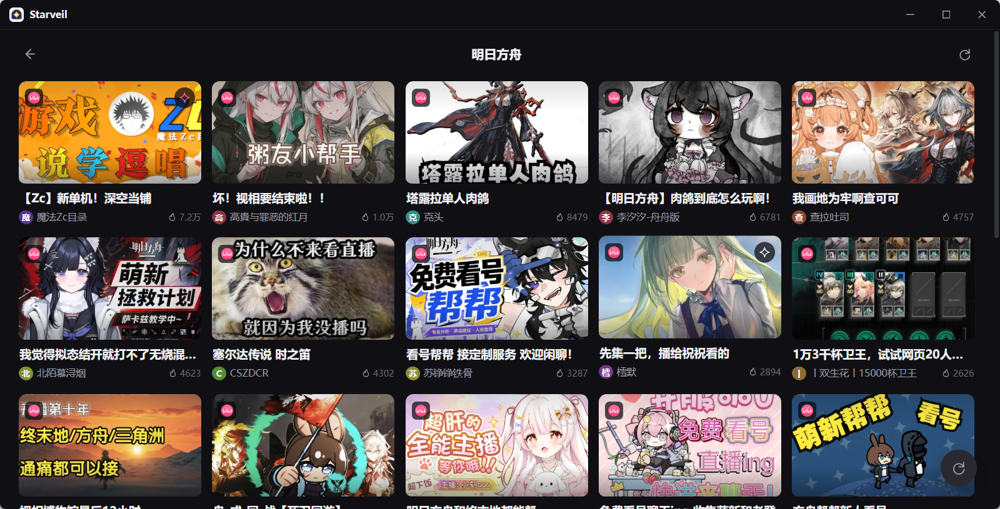
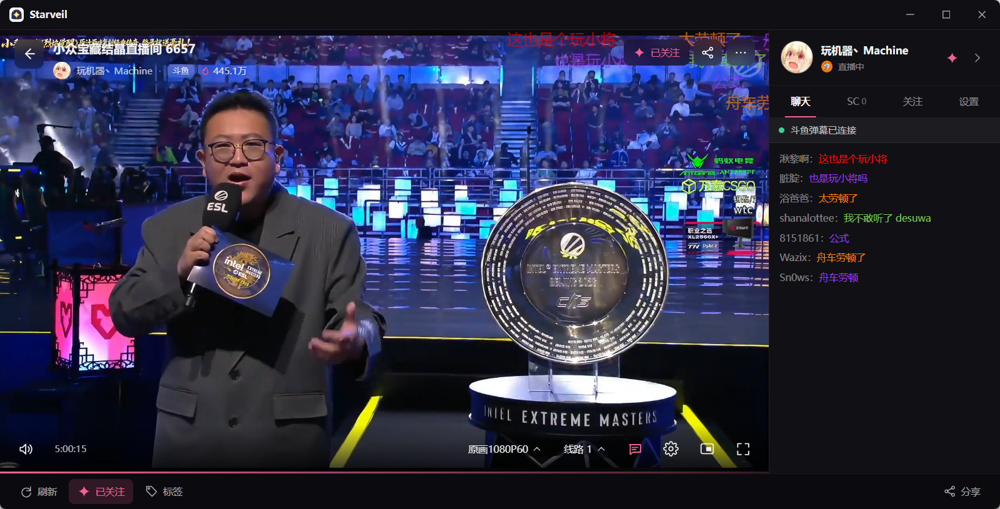
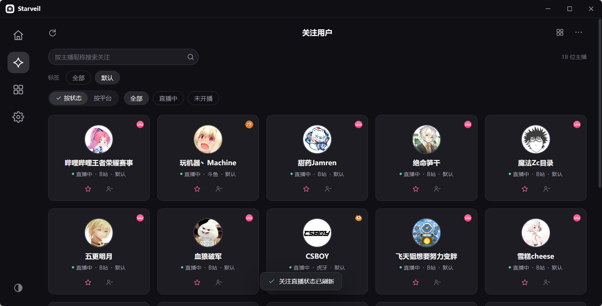
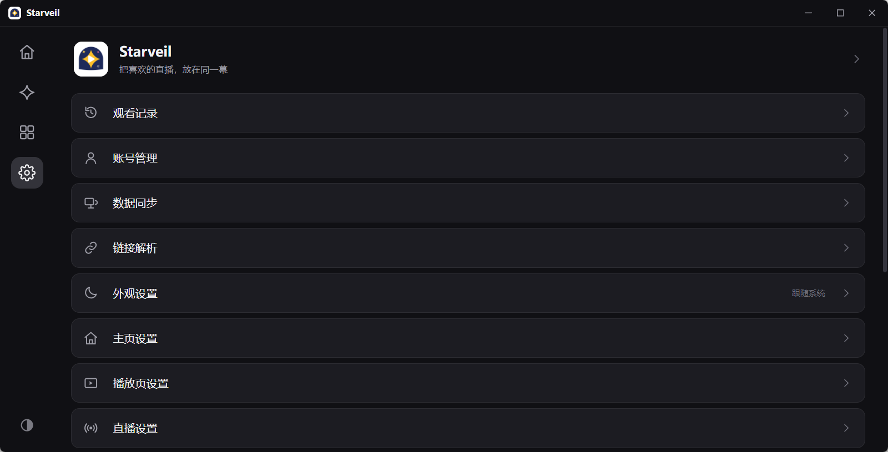
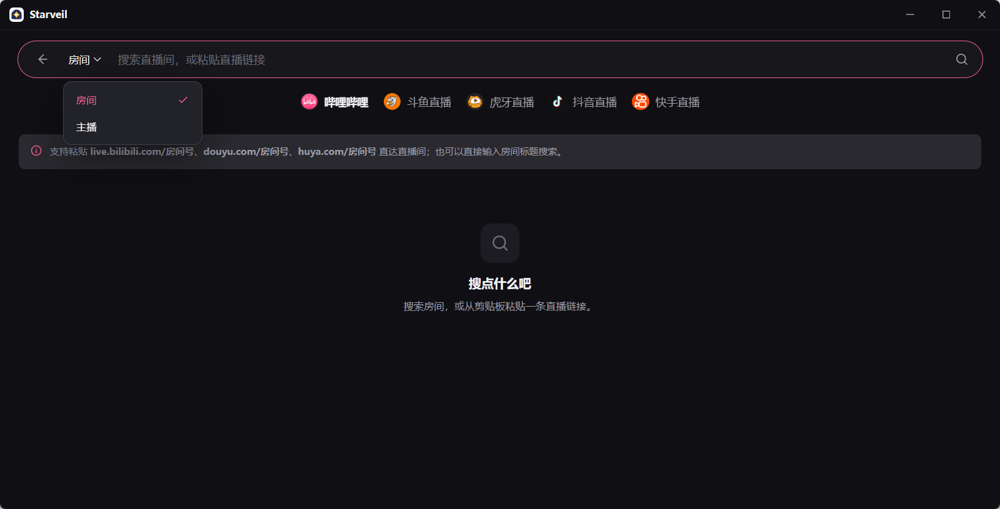
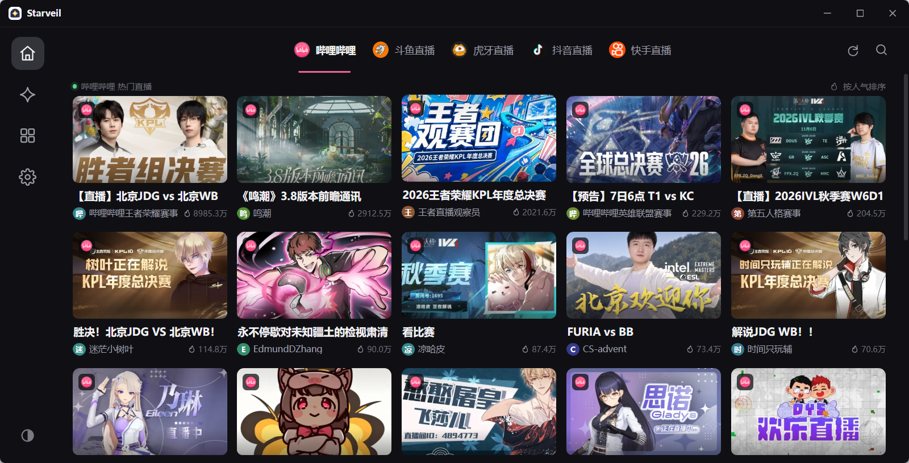
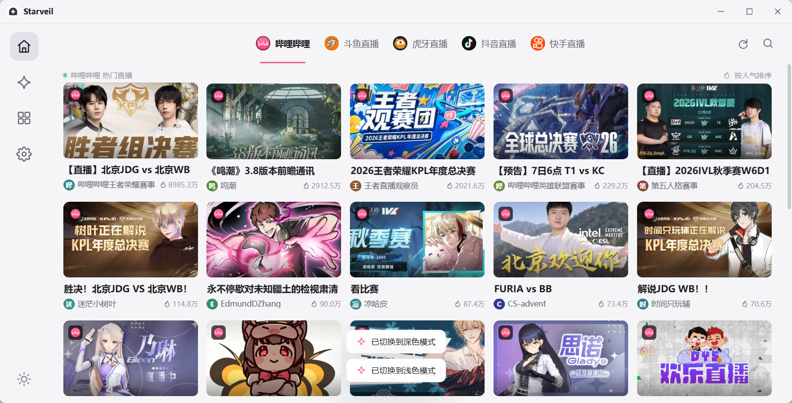

# Starveil

用 **Tauri 2 + WebView** 写的聚合直播客户端，支持哔哩哔哩 / 斗鱼 / 虎牙 / 抖音 / 快手的
推荐、分类、搜索、直播间与播放。界面是纯 HTML / CSS / ES Modules（无前端框架），
播放走 mpegts.js（FLV）与 hls.js（HLS），协议层是 Rust 的 [`live_core`](src-tauri/vendor/live_core)。

> **0.7.0** · Windows 10/11 x64 · Android 8.0+（arm64-v8a） · GPL-3.0 · 非官方第三方客户端，仅供学习交流



## 功能

- **平台**：五站推荐 / 分类 / 搜索 / 直播间 / 播放。B 站、斗鱼、虎牙、抖音有弹幕，
  快手弹幕未接入；抖音的搜索与快手的搜索需要额外签名或注册流程，界面会给出提示。
- **播放**：FLV 走 mpegts.js、HLS 走 hls.js，线路菜单标出协议；清晰度与线路切换、
  断流自动换线重连；另有**只播放音频**、**延迟播放**（0 ~ 20 秒抗抖动缓冲）、
  **同屏播放**（B 铺满画面、当前房间缩为小窗，可互换主次）。
- **弹幕**：canvas 渲染 + 虚拟轨道避让，支持颜色、字号、粗细、不透明度、描边、显示区域、
  行数、速度、帧率上限、重复过滤与关键词 / 用户屏蔽；性能档位（平衡 / 流畅 / 极速）；
  大表情按 1 ~ 5 行显示并按实际占用轨道避让。弹幕流与直播流互相独立，
  暂停、缓冲、断流重连、未开播都不影响弹幕接收。
- **直播间**：右侧聊天面板分 聊天 / SC / 关注 / 设置 四栏，SC 分「正在显示 / 历史」；
  底部控制条为三段式（音量 · 时间 / 画质 / 线路 / 弹幕 / 设置 · 全屏），窄屏按优先级收起；
  单击唤出控件，双击或 `F` 全屏，`D` 开关弹幕，`Esc` 返回，`↑ / ↓` 调音量。
- **首页 / 分类 / 搜索**：封面卡网格（平台角标、标题、主播、人气）与「加载更多」；
  分类页一级分区 + 二级图标网格；搜索支持关键词、房间号、直播间链接与主播模式。
- **关注**：关注 / 取关、标签分组、按直播状态或平台筛选、网格 / 列表切换、
  按进房热度排序、导入导出。
- **观看记录与统计**：记录 / 统计两个视图，统计按本周 / 本月 / 今年 / 全部聚合，
  给出总时长、次数、主播数、日均与主播时长排行。
- **数据同步**：本机备份、从 dart_simple_live 迁移、局域网直连（同 Wi-Fi 自动发现）、
  WebDAV（跨网络）；同步包内容可勾选（观看记录、登录 Cookie 各自默认）。
- **皮肤**：配色、圆角、阴影、字体、动效、图标质感、窗口按钮形态、压在视频上的浮层与悬停提示
  全部来自 `web/skins/<id>/skin.css`，组件样式只消费变量；深浅色是独立维度，皮肤可只提供一档并锁定。
  内置「星幕」（六种主题色 + 自定义色，深 / 浅双档）与「苹果」（浅色单档，macOS 红绿灯）。
- **桌面外壳**：无边框 + 自绘 38px 标题栏，关闭即退出、不驻留后台，可多开。
- **Android**：竖屏底部 TabBar、横屏左侧栏；直播间竖屏上下分栏，控件收进「更多」；
  系统画中画、屏幕方向锁定、系统栏跟随主题、返回键走应用内层级。

## 截图

| 首页 | 分类 | 分类房间列表 |
| --- | --- | --- |
|  |  |  |

| 直播间 | 关注 | 设置 |
| --- | --- | --- |
|  |  |  |

| 搜索 | 标题栏（深色） | 标题栏（浅色） |
| --- | --- | --- |
|  |  |  |

## 技术栈

| 层 | 选型 | 说明 |
| --- | --- | --- |
| 外壳 | Tauri 2 | Windows 用 WebView2，Android 用系统 WebView |
| 界面 | HTML / CSS / ES Modules | 无构建步骤，改完刷新即可 |
| 播放 | mpegts.js / hls.js | FLV over MSE 与 HLS |
| 弹幕 | fly-barrage | canvas + 虚拟轨道，避免叠字 |
| 协议层 | Rust `live_core` | 五站详情、取流、推荐、分类、搜索、弹幕 |
| 流代理 | 内置 `127.0.0.1` 转发 | 补齐 CDN 需要的 Referer / CORS，到期换上游不断流 |

## 运行与构建

**环境**：Windows 10/11 x64、WebView2 运行时、Rust 1.95（`rust-toolchain.toml` 已固定）、
`cargo-tauri` 2.6+。构建 Android 另需 Android SDK / NDK 与 JDK 17。

```bash
cd src-tauri && cargo run                        # 开发：前端无构建步骤，资源直接嵌入
cargo tauri build --no-bundle                    # 打包：产物 src-tauri/target/release/starveil.exe
cargo tauri android build --apk --target aarch64 # Android 真机 / 发布
```

产物在 `src-tauri/gen/android/app/build/outputs/apk/`。`gen/android` 已入库，
**改包名后必须删掉重新 `cargo tauri android init`**。

**界面调试**：Debug 与 Release 都不带 DevTools（WebView2 不接受 `--remote-debugging-port`），
界面调试走 Edge 预览：

```bash
python tools/serve.py 1420 web                   # 禁缓存的静态服务
# 另开 Edge 指向 http://127.0.0.1:1420/index.html?titlebar=1，加 --remote-debugging-port=9225
CDP_PORT=9225 node tools/cdp.mjs shot shot.png   # 截图 / eval / reload / console
```

**数据位置**：桌面端存在 `%LOCALAPPDATA%\Starveil\WebView2`，删除该目录会同时清掉设置与登录态；
Android 在应用私有目录 `/data/data/com.banlany.starveil`，卸载即清空。

## 目录结构

```
Starveil/
├─ src-tauri/
│  ├─ src/                  命令层、WebDAV、局域网同步、Windows 集成
│  ├─ src/lib.rs            推荐 / 搜索 / 分类 / 房间 / 取流 / 弹幕 / 登录
│  ├─ src/main.rs           桌面入口（安卓入口是 lib.rs 的 mobile_entry_point）
│  ├─ gen/android/          Android 工程，MainActivity.kt 提供方向 / 小窗 / 系统栏桥接
│  └─ vendor/live_core/     内嵌直播协议层（五站）
├─ web/
│  ├─ index.html            首帧前按皮肤预涂 data-skin / data-theme
│  ├─ skins/                registry.js + <id>/skin.css（+ 可选 icons.js）
│  ├─ styles.css            外壳、控件、弹窗（只消费皮肤变量）
│  ├─ pages.css             首页 / 分类 / 关注 / 设置 / 搜索
│  ├─ room.css              直播间、弹幕、聊天、播放控制
│  ├─ mobile.css            移动端布局（全部挂在 html.is-mobile 下）
│  ├─ js/                   app / api / store / danmaku / tooltip / titlebar / pages/
│  └─ vendor/               mpegts.js、hls.js、fly-barrage、cryptojs、qrcode
├─ tools/                   check-skin / serve / cdp / shot / make_icon
├─ docs/                    皮肤契约、弹幕库改动清单、界面截图
└─ .github/workflows/       CI：Windows 与 Android 并行构建，手动触发
```

## 后端命令

| 命令 | 说明 |
| --- | --- |
| `recommend` / `search` / `search_anchors` | 推荐、搜索直播间、搜索主播 |
| `categories` / `category_rooms` | 分类树、分类下直播间 |
| `open_room` / `play` | 房间详情与清晰度、按清晰度取直链与请求头 |
| `start_danmaku` / `stop_danmaku` | 弹幕订阅，消息走 `danmaku-batch`，状态走 `danmaku-status` |
| `resolve_input` | 链接 / 房间号解析 |
| `set_cookie` / `clear_cookie` / `login_status` | 登录态注入、清除与校验 |
| `open_login_window` / `capture_login` / `bili_qr_*` | 独立登录窗口、读取 Cookie、B 站扫码 |
| `webdav_test` / `webdav_upload` / `webdav_download` | WebDAV 探活与整包收发 |
| `lan_sync_*` | 局域网同步服务的启停、发布、收取与对端拉推 |
| `set_screen_orientation` / `enter_picture_in_picture` / `set_system_bar` | 安卓方向、小窗、系统栏 |

## 文档

- [CHANGELOG.md](CHANGELOG.md)：版本变更记录
- [docs/skins.md](docs/skins.md)：皮肤协议（注册表字段、变量契约、新增皮肤步骤）
- [docs/skin-components.md](docs/skin-components.md)：按界面区域查组件消费的变量，附常用配方
- [docs/fly-barrage-changes.md](docs/fly-barrage-changes.md)：弹幕库改动清单与重建步骤

## 已知限制

- **播放内核**：FLV 走 mpegts.js、HLS 走 hls.js，画质切换细节与原生 mpv 不完全一致；
  虎牙与斗鱼只提供 FLV（没有可用的 HLS 出口）。
- **快手弹幕**未接入（自定义 protobuf + 页面下发 token）；快手搜索需要 did 注册，暂不可用。
- **发送弹幕**默认隐藏，且目前只有 B 站实现。
- **斗鱼**：直链带 `expire=300`，到期由代理换上游并重组 FLV，接缝处丢约 1 秒画面；
  网页端拿不到「原画 2K」这一档，清晰度列表按接口返回展示。
- **Android**：斗鱼弹幕走 8601 明文端口，个别企业 / 校园网会拦截；
  退到后台会暂停播放，不支持后台听声；编解码取决于系统 WebView 版本。
- **桌面**：自绘标题栏失去了 Windows 原生的贴边吸附；关闭即退出，没有托盘常驻与后台播放。
- **数据**默认只在本机。只有配置了 WebDAV 并手动触发（或显式打开自动拉取）时，
  才会把不含 Cookie 的同步包上传；局域网同步也只在打开「数据同步」页时启动。

## 排查

- **窗口全黑**：部分环境下 WebView2 的 GPU 进程起不来。程序建窗前会检测进程是否处于 Job 中，
  是则自动关闭 GPU 沙箱并记住结论（`%LOCALAPPDATA%\Starveil\gpu-sandbox-broken.flag`）。
  需要手动控制时用 `STARVEIL_FORCE_GPU_SANDBOX=1` 或 `STARVEIL_DISABLE_GPU_SANDBOX=1`。
- **运行日志**：Windows 在 `%LOCALAPPDATA%\Starveil\starveil.log`，Android 在应用私有目录的
  `logs/starveil.log`。设置 → 其他 → 维护里可直接打开。反馈问题时请附上。
- **Chromium 自身日志**：设 `WEBVIEW2_ADDITIONAL_BROWSER_ARGUMENTS=--enable-logging --v=1 --log-file=<路径>`。

## 许可与致谢

本项目是独立仓库，不是原项目的官方分支。界面结构、交互与平台图标参考
[`dart_simple_live`](https://github.com/xiaoyaocz/dart_simple_live)（GPL-3.0）；
各平台的房间信息、清晰度、取流签名与弹幕编解码移植自其 `simple_live_core`，
因此本项目属于衍生作品，沿用 **GPL-3.0**，完整源码见 [LICENSE](LICENSE)。
协议层各文件的来源、素材与商标说明见 [THANKS.md](THANKS.md)。

依赖：[mpegts.js](https://github.com/xqq/mpegts.js)（Apache-2.0）、
[hls.js](https://github.com/video-dev/hls.js)（Apache-2.0）、
[fly-barrage](https://github.com/feiafei27/fly-barrage)（MIT）、
CryptoJS（MIT）、qrcode-generator（MIT）。

## 免责声明

本项目仅用于个人学习与技术研究，不提供、不存储、不转播任何直播内容，也不绕过平台的付费或登录限制。
所有视频流、弹幕、封面与商标归各平台及主播所有。请遵守所在地区法律法规与平台服务条款，
请勿用于商业用途；因使用本项目产生的后果由使用者自行承担。
